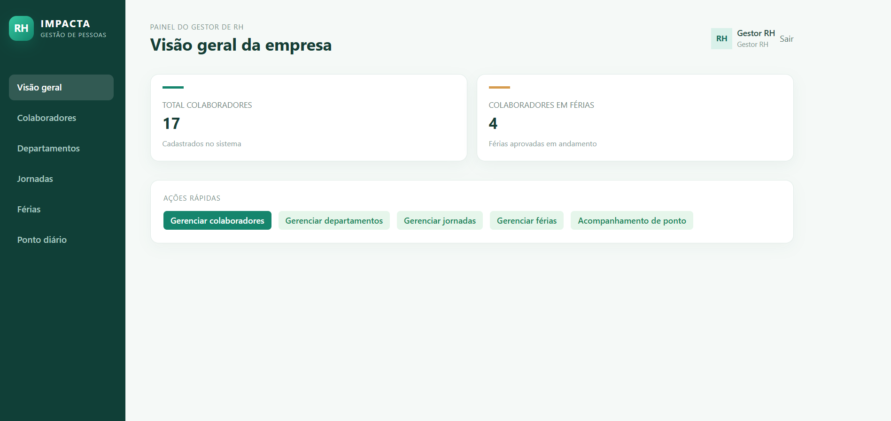
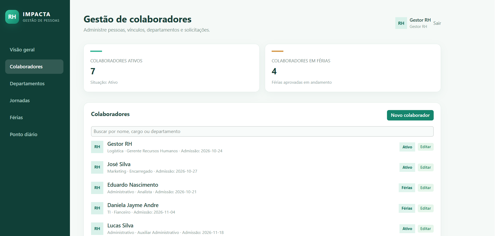
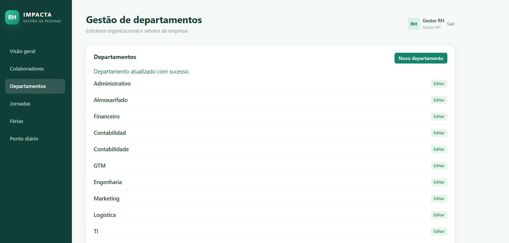
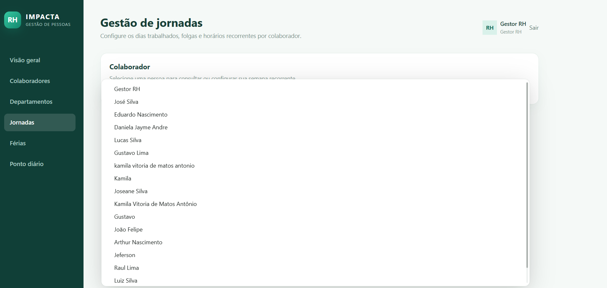
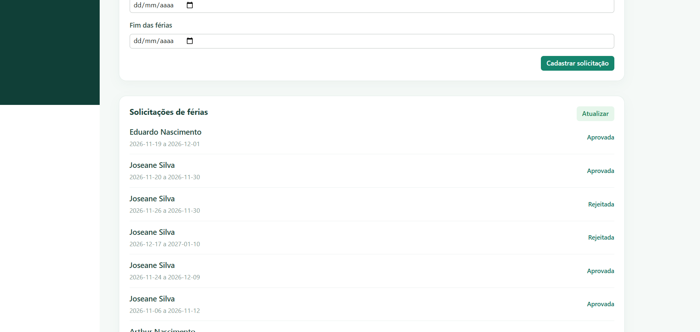
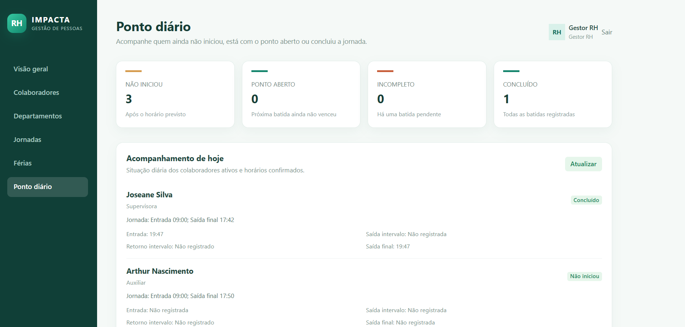

# IMPACTA --- Gestão de Pessoas

Sistema web de gerenciamento de Recursos Humanos desenvolvido para
centralizar e facilitar rotinas administrativas relacionadas aos
colaboradores, departamentos, jornadas de trabalho, férias e
acompanhamento diário de ponto.

O aplicativo permite que o gestor de RH consulte informações da equipe,
mantenha os cadastros organizados, analise solicitações de férias e
acompanhe ocorrências nos registros de jornada.

------------------------------------------------------------------------

## Sumário

-   [1. Apresentação](#1-apresentação)
-   [2. Acesso ao aplicativo](#2-acesso-ao-aplicativo)
-   [3. Perfis de usuários](#3-perfis-de-usuários)
-   [4. Funcionalidades](#4-funcionalidades)
-   [5. Manual de utilização](#5-manual-de-utilização)
-   [6. Exemplos de utilização](#6-exemplos-de-utilização)
-   [7. Limitações conhecidas](#7-limitações-conhecidas)
-   [8. Tecnologias utilizadas](#8-tecnologias-utilizadas)
-   [9. Instalação e execução local](#9-instalação-e-execução-local)
-   [10. Publicação do sistema
    (Deploy)](#10-publicação-do-sistema-deploy)
-   [11. Atualização da versão
    publicada](#11-atualização-da-versão-publicada)

------------------------------------------------------------------------

## 1. Apresentação

O **Impacta --- Gestão de Pessoas** é um aplicativo web criado para
apoiar o gerenciamento de Recursos Humanos de uma empresa.

A solução reúne em um só ambiente recursos para cadastro e consulta de
colaboradores, organização de departamentos, configuração de jornadas,
análise de solicitações de férias e acompanhamento dos registros diários
de ponto.

### Problema que o sistema busca resolver

A utilização de controles manuais e informações distribuídas pode
dificultar o acompanhamento dos funcionários e das rotinas do RH. O
sistema busca centralizar essas informações, facilitar a consulta pelo
gestor e ajudar na identificação de pendências, como solicitações de
férias aguardando análise e marcações de ponto não realizadas.

### Público-alvo

-   Gestores de Recursos Humanos.
-   Profissionais responsáveis pela administração de pessoal.
-   Colaboradores que utilizam as funções disponibilizadas para
    solicitar férias e registrar ou acompanhar suas marcações, conforme
    as permissões do sistema.

## 2. Acesso ao aplicativo

**Endereço do aplicativo publicado:** a versão de produção ainda precisa
ser publicada para que este campo receba uma URL definitiva.

Após realizar o deploy, substitua esta observação pelo endereço público,
por exemplo:

`https://seu-aplicativo.reflex.app`

O endereço acima é apenas ilustrativo. Utilize a URL efetivamente
fornecida pelo serviço de hospedagem.

### Orientações de acesso

1.  Abra um navegador atualizado.
2.  Acesse o endereço público do sistema.
3.  Entre com as credenciais disponibilizadas para seu perfil.
4.  Utilize o menu lateral para navegar entre as áreas disponíveis.

O acesso às telas e às operações depende do perfil e das permissões
configuradas no aplicativo.

## 3. Perfis de usuários

### 3.1. Gestor de RH

O gestor é responsável pela administração das informações de Recursos
Humanos e pelo acompanhamento da equipe.

Entre suas atividades estão:

-   Consultar o painel geral da empresa.
-   Visualizar os colaboradores cadastrados.
-   Adicionar novos colaboradores e editar cadastros existentes.
-   Consultar e organizar departamentos.
-   Configurar jornadas de trabalho e folgas.
-   Consultar solicitações de férias.
-   Aprovar ou rejeitar solicitações de férias.
-   Acompanhar os registros diários de ponto.
-   Identificar colaboradores que ainda não iniciaram a jornada.
-   Identificar pontos abertos ou incompletos.
-   Verificar possíveis atrasos comparando o horário previsto com as
    marcações registradas.

### 3.2. Colaborador

O colaborador utiliza as funcionalidades disponibilizadas para seu
perfil. De acordo com os recursos habilitados no sistema, pode:

-   Solicitar férias, informando o período desejado.
-   Consultar a situação de uma solicitação.
-   Realizar as marcações de ponto disponibilizadas pelo aplicativo.

> As permissões efetivamente disponíveis para cada perfil devem
> corresponder à configuração da versão publicada.

## 4. Funcionalidades

### 4.1. Visão geral

Apresenta indicadores resumidos da empresa, como:

-   Total de colaboradores cadastrados.
-   Quantidade de colaboradores em férias.
-   Atalhos para acessar as principais áreas administrativas.

### 4.2. Colaboradores

Permite consultar e administrar os funcionários cadastrados.

-   Cadastrar um novo colaborador.
-   Editar informações de um cadastro.
-   Pesquisar por nome, cargo ou departamento.
-   Consultar informações profissionais e situação do colaborador.
-   Identificar funcionários ativos ou em férias, conforme os dados
    registrados.

### 4.3. Departamentos

Permite organizar os setores da empresa.

-   Consultar departamentos cadastrados.
-   Adicionar novos departamentos.
-   Editar departamentos existentes.

Exemplos de setores que podem ser cadastrados: Administrativo,
Almoxarifado, Financeiro, Contabilidade, Engenharia, Marketing,
Logística e TI.

### 4.4. Jornadas

Permite consultar e configurar a jornada recorrente dos colaboradores.

-   Selecionar um colaborador.
-   Consultar sua jornada.
-   Definir dias trabalhados.
-   Definir folgas.
-   Configurar horários de trabalho, conforme os campos disponíveis.

### 4.5. Férias

Centraliza as solicitações de férias.

-   Consultar o colaborador solicitante.
-   Verificar as datas de início e término.
-   Analisar a solicitação.
-   Aprovar ou rejeitar o pedido.
-   Consultar a situação das solicitações.

Os estados apresentados podem incluir:

-   **Pendente:** aguardando análise do gestor.
-   **Aprovada:** solicitação autorizada.
-   **Rejeitada:** solicitação não autorizada.

### 4.6. Ponto diário

Apresenta o acompanhamento das marcações de jornada dos colaboradores.

O painel utiliza indicadores para facilitar a identificação de situações
que precisam de atenção:

-   **Não iniciou:** não há registro de início da jornada até o momento
    da consulta, considerando o horário previsto.
-   **Ponto aberto:** a jornada foi iniciada e ainda não foi encerrada.
-   **Incompleto:** existe uma marcação prevista que ainda não foi
    registrada.
-   **Concluído:** as marcações esperadas para a jornada foram
    registradas.

O gestor também pode consultar, quando disponíveis:

-   Nome e função do colaborador.
-   Horário previsto da jornada.
-   Entrada.
-   Saída para intervalo.
-   Retorno do intervalo.
-   Saída final.

A identificação de atraso depende da comparação entre o horário previsto
e o horário efetivamente registrado.

## 5. Manual de utilização

As imagens abaixo ilustram as telas do sistema. Para que apareçam no
GitHub, salve as capturas de tela no repositório com os nomes indicados
em `docs/imagens/`.

### 5.1. Acessar o painel geral



1.  Entre no sistema com suas credenciais.
2.  Acesse a opção **Visão geral** no menu lateral.
3.  Consulte o total de colaboradores.
4.  Verifique a quantidade de colaboradores em férias.
5.  Utilize os atalhos para acessar os módulos de gestão.

**Resultado esperado:** visualizar um resumo dos principais indicadores
e acessar as áreas do sistema.

### 5.2. Cadastrar ou editar um colaborador



1.  No menu lateral, clique em **Colaboradores**.
2.  Para adicionar uma pessoa, clique em **Novo colaborador**.
3.  Preencha os campos apresentados no formulário.
4.  Informe os dados pessoais e profissionais solicitados.
5.  Salve o cadastro.
6.  Para localizar alguém já cadastrado, utilize a busca por nome, cargo
    ou departamento.
7.  Clique em **Editar** ao lado do colaborador para alterar seus dados
    e salve as modificações.

**Resultado esperado:** o novo colaborador será incluído na relação ou
as informações do cadastro existente serão atualizadas.

### 5.3. Cadastrar ou editar um departamento



1.  Acesse **Departamentos** no menu lateral.
2.  Consulte a lista de setores existentes.
3.  Clique em **Novo departamento** para adicionar um setor.
4.  Informe o nome solicitado.
5.  Confirme o cadastro.
6.  Para alterar um setor existente, clique em **Editar**, faça a
    modificação e salve.

**Resultado esperado:** a estrutura de departamentos ficará atualizada
para utilização nos cadastros, conforme as regras do sistema.

### 5.4. Configurar a jornada de um colaborador



1.  Acesse **Jornadas**.
2.  Selecione o colaborador na lista.
3.  Consulte a jornada cadastrada.
4.  Configure os dias de trabalho e as folgas.
5.  Informe os horários solicitados pelo formulário.
6.  Salve as configurações.

**Resultado esperado:** a jornada ficará registrada para servir de
referência ao acompanhamento dos horários e das marcações.

### 5.5. Analisar uma solicitação de férias



1.  Acesse **Férias**.
2.  Localize a solicitação do colaborador.
3.  Confira o nome e o período solicitado.
4.  Analise as informações.
5.  Selecione **Aprovar** ou **Rejeitar**, conforme a decisão.
6.  Consulte a situação atualizada da solicitação.

**Resultado esperado:** a solicitação passa a apresentar o status
correspondente à decisão do gestor.

### 5.6. Acompanhar o ponto diário



1.  Acesse **Ponto diário**.
2.  Consulte os indicadores apresentados no início da tela.
3.  Verifique quantos colaboradores não iniciaram a jornada.
4.  Confira se existem registros abertos ou incompletos.
5.  Localize o colaborador na listagem.
6.  Analise o horário previsto e as marcações registradas.
7.  Compare o horário previsto com o horário de entrada para identificar
    possíveis atrasos.
8.  Utilize a opção **Atualizar**, quando disponível, para consultar os
    dados mais recentes.

**Resultado esperado:** o gestor consegue identificar colaboradores com
marcações pendentes, jornadas em andamento e possíveis atrasos.

### 5.7. Solicitar férias como colaborador

1.  Entre no sistema com o perfil de colaborador.
2.  Acesse a área de férias disponibilizada para esse perfil.
3.  Informe a data de início e a data de término desejadas.
4.  Confira as informações.
5.  Clique em **Cadastrar solicitação**.
6.  Consulte posteriormente a situação do pedido.

**Resultado esperado:** a solicitação será registrada para análise do
gestor, conforme as regras do sistema.

## 6. Exemplos de utilização

### Exemplo 1 --- Inclusão de um novo funcionário

A empresa contrata um novo auxiliar administrativo. O gestor acessa
**Colaboradores**, seleciona **Novo colaborador**, preenche os dados
solicitados e salva. O funcionário passa a aparecer na listagem de
colaboradores.

### Exemplo 2 --- Aprovação de férias

Um funcionário solicita férias de 19/11/2026 a 01/12/2026. O gestor
acessa **Férias**, localiza o pedido, confere o período e aprova a
solicitação. O status passa a ser exibido como **Aprovada**.

### Exemplo 3 --- Identificação de colaborador que não iniciou a jornada

O horário previsto de entrada de um funcionário é 09h00. Após esse
horário, o gestor consulta **Ponto diário** e verifica que não existe
registro de entrada. O painel pode apresentar a situação **Não
iniciou**, permitindo que a ocorrência seja identificada.

### Exemplo 4 --- Identificação de ponto incompleto

Um colaborador registra a entrada, mas não realiza uma das marcações
previstas. O gestor consulta o acompanhamento diário e verifica a
situação **Incompleto**, podendo identificar a pendência.

### Exemplo 5 --- Organização de setores

A empresa cria um novo departamento. O gestor acessa **Departamentos**,
seleciona **Novo departamento**, informa o nome do setor e salva. O
departamento passa a integrar a estrutura cadastrada.

## 7. Limitações conhecidas

As funcionalidades disponíveis dependem da implementação e da
configuração da versão entregue.

Pontos que devem ser considerados:

-   O acompanhamento de ponto depende dos horários de jornada e das
    marcações cadastradas.
-   A identificação de atrasos depende de horários previstos válidos e
    de registros de ponto disponíveis.
-   A análise de férias depende das solicitações registradas e das ações
    permitidas ao gestor.
-   A disponibilidade de cada tela depende das permissões configuradas
    para o perfil.
-   O acesso externo depende da publicação do aplicativo e da
    configuração correta dos serviços utilizados.
-   Integrações externas, notificações automáticas, relatórios avançados
    e exportação de dados só devem ser consideradas disponíveis se
    estiverem implementadas e habilitadas na versão entregue.

Antes da entrega, atualize esta seção com eventuais problemas ou
funcionalidades que ainda não estejam implementados. Não descreva como
disponível um recurso que não possa ser utilizado na versão publicada.

## 8. Tecnologias utilizadas

Conforme a estrutura e a configuração do projeto:

-   **Python:** linguagem utilizada no desenvolvimento.
-   **Reflex:** framework utilizado para construir a aplicação web.
-   **Xano:** serviço de backend/API utilizado pelo sistema.

A configuração exata de versões e dependências deve ser consultada nos
arquivos do projeto, especialmente `requirements.txt` e `rxconfig.py`.

## 9. Instalação e execução local

### 9.1. Pré-requisitos

-   Python instalado e configurado no computador.
-   Git instalado.
-   Acesso ao repositório do projeto.
-   Acesso às configurações da API utilizada pelo sistema.
-   Ambiente virtual Python.

### 9.2. Clonar o repositório

Abra o PowerShell ou terminal e execute:

``` powershell
git clone https://github.com/raulnasctech/Projeto-RH.git
```

Entre na pasta clonada:

``` powershell
cd Projeto-RH
```

Confira os arquivos e pastas:

``` powershell
dir
```

### 9.3. Entrar na pasta da aplicação

Na estrutura utilizada neste projeto, a aplicação Reflex está na pasta
`Gestao_RH_Impacta`.

``` powershell
cd Gestao_RH_Impacta
```

Confira se os arquivos da aplicação estão presentes:

``` powershell
dir
```

Verifique especialmente a existência de `requirements.txt` e
`rxconfig.py`.

> Se a estrutura de pastas do repositório tiver sido alterada, ajuste o
> caminho acima para a pasta que contém o arquivo de configuração do
> Reflex.

### 9.4. Criar e ativar o ambiente virtual

Crie o ambiente virtual:

``` powershell
python -m venv venv
```

Ative-o no PowerShell:

``` powershell
.\venv\Scripts\Activate.ps1
```

Se o terminal indicar que a execução de scripts está bloqueada, execute
o comando abaixo na sessão atual do PowerShell e tente ativar novamente:

``` powershell
Set-ExecutionPolicy -Scope Process -ExecutionPolicy Bypass
```

Após a ativação, o terminal deverá exibir `(venv)` no início da linha.

### 9.5. Instalar as dependências

Com o ambiente virtual ativado, atualize o instalador:

``` powershell
python -m pip install --upgrade pip
```

Instale as dependências:

``` powershell
pip install -r requirements.txt
```

Se o arquivo `requirements.txt` não existir, consulte a configuração de
dependências do projeto antes de gerar um novo arquivo. Em um ambiente
já preparado com todas as dependências corretas, ele pode ser gerado
com:

``` powershell
pip freeze > requirements.txt
```

### 9.6. Configurar as variáveis de ambiente

O sistema utiliza uma variável de ambiente para acessar a API do Xano:

``` text
XANO_AUTH_API_URL
```

Configure essa variável com a URL correta fornecida para o ambiente do
projeto. Não compartilhe tokens, credenciais ou valores secretos no
README ou no repositório.

Se o projeto utilizar um arquivo `.env`, mantenha-o fora do Git e
confira se `.env` está incluído no `.gitignore`. Para execução local,
utilize o mecanismo de configuração de variáveis de ambiente previsto no
código.

### 9.7. Executar o aplicativo

Na pasta que contém a aplicação Reflex e com o ambiente virtual ativado,
execute:

``` powershell
reflex run
```

Aguarde a inicialização e abra no navegador o endereço local informado
pelo terminal.

Para encerrar a execução, pressione `Ctrl + C` no terminal.

## 10. Publicação do sistema (Deploy)

Esta seção descreve como publicar a aplicação utilizando o **Reflex
Cloud**. O deploy é uma etapa separada do envio do código ao GitHub: ter
o projeto no repositório não significa que ele já esteja disponível na
internet.

### 10.1. Preparar o projeto

1.  Abra o PowerShell.
2.  Entre na pasta do repositório:

``` powershell
cd caminho\para\Projeto-RH
```

3.  Atualize a cópia local com a versão mais recente da branch
    principal:

``` powershell
git pull origin main
```

4.  Entre na pasta da aplicação Reflex:

``` powershell
cd Gestao_RH_Impacta
```

5.  Ative o ambiente virtual:

``` powershell
.\venv\Scripts\Activate.ps1
```

6.  Confirme que o aplicativo executa localmente:

``` powershell
reflex run
```

Se o projeto estiver funcionando, encerre a execução com `Ctrl + C`.

### 10.2. Conferir as dependências

O Reflex Cloud requer um arquivo `requirements.txt` no diretório
principal da aplicação, contendo as dependências Python necessárias.

Se o arquivo já existir, confira se ele está atualizado. Em um ambiente
virtual preparado com as dependências corretas, pode-se gerar ou
atualizar o arquivo com:

``` powershell
pip freeze > requirements.txt
```

Confira também se a versão instalada do Reflex atende ao requisito atual
do serviço de hospedagem (Reflex `0.6.6` ou superior, conforme a
documentação consultada).

### 10.3. Criar uma conta e autenticar no Reflex Cloud

1.  Acesse [Reflex Cloud](https://cloud.reflex.dev/).
2.  Entre na sua conta ou crie uma conta.
3.  No terminal, ainda dentro da pasta da aplicação, execute:

``` powershell
reflex login
```

4.  O navegador será aberto para autenticação.
5.  Conclua o login e retorne ao terminal.

### 10.4. Criar ou selecionar o projeto de hospedagem

1.  No painel do Reflex Cloud, abra o projeto correspondente à
    aplicação.
2.  Acesse a seção **Deployments**.
3.  Se ainda não houver uma publicação, procure a opção **How to
    deploy**.
4.  Selecione o fluxo de publicação pela linha de comando (CLI).
5.  Copie o comando de deploy específico apresentado pelo painel.

O comando terá um formato semelhante a este:

``` powershell
reflex deploy --project SEU_ID_DO_PROJETO
```

`SEU_ID_DO_PROJETO` é um marcador ilustrativo. Substitua-o pelo
identificador real fornecido pelo Reflex Cloud. Não utilize um ID
inventado.

### 10.5. Configurar a variável de ambiente do Xano

A aplicação precisa receber a configuração da API do Xano no ambiente
publicado.

1.  No painel do Reflex Cloud, abra o aplicativo publicado ou em
    configuração.
2.  Acesse **Settings \> Secrets** (ou a área equivalente de variáveis
    de ambiente).
3.  Adicione a variável:

``` text
XANO_AUTH_API_URL
```

4.  Informe o valor correspondente à URL da API do Xano utilizada pelo
    projeto.
5.  Salve a configuração e reinicie a aplicação, se solicitado.

**Segurança:** não coloque a URL com credenciais, tokens ou outros
segredos diretamente no README, no código público ou em capturas de
tela. Não envie o arquivo `.env` ao GitHub. Armazene valores sensíveis
na área de Secrets do serviço de hospedagem.

### 10.6. Executar o deploy

1.  Volte ao terminal, dentro da pasta `Gestao_RH_Impacta`.
2.  Execute o comando específico copiado do painel do Reflex Cloud.
3.  Responda às confirmações apresentadas pelo terminal.
4.  Aguarde o envio dos arquivos, a compilação e a publicação.
5.  Acompanhe o status no painel **Deployments**.

O processo pode levar alguns minutos. A publicação estará concluída
quando o painel indicar que o deploy foi finalizado e disponibilizar o
endereço do aplicativo.

### 10.7. Testar a versão publicada

Depois da publicação:

1.  Copie a URL pública exibida no painel.
2.  Abra o endereço em uma nova aba ou janela do navegador.
3.  Teste o acesso com as credenciais apropriadas.
4.  Confira as telas de visão geral, colaboradores, departamentos,
    jornadas, férias e ponto diário.
5.  Verifique se a comunicação com o Xano está funcionando.
6.  Teste as operações principais e confirme se os dados são
    apresentados corretamente.

Se houver falhas, consulte os logs da aplicação na área de Deployments
antes de considerar a publicação concluída.

### 10.8. Registrar a URL no README

Depois de obter a URL real, volte à seção [2. Acesso ao
aplicativo](#2-acesso-ao-aplicativo) e substitua o aviso de que o deploy
ainda precisa ser realizado pelo endereço público definitivo.

**Documentação oficial:** - [Reflex Cloud --- Quick
Start](https://reflex.dev/docs/hosting/deploy-quick-start/) - [Reflex
Cloud --- Secrets e variáveis de
ambiente](https://reflex.dev/docs/hosting/secrets-environment-vars/) -
[Reflex Cloud --- Deploy
CLI](https://reflex.dev/docs/hosting/cli/deploy/)

## 11. Atualização da versão publicada

Quando houver alterações no código, siga este fluxo:

### 11.1. Enviar as alterações ao GitHub

Na pasta do repositório, execute:

``` powershell
git status
git add .
git commit -m "Atualiza sistema de RH"
git push origin main
```

O comando `git push` envia as alterações para o GitHub, mas não garante,
por si só, que a versão hospedada foi atualizada.

### 11.2. Publicar a nova versão

Para atualizar a aplicação no Reflex Cloud:

1.  Entre na pasta da aplicação.
2.  Ative o ambiente virtual.
3.  Confirme que as dependências e variáveis de ambiente estão corretas.
4.  Execute novamente o comando de deploy específico do projeto, copiado
    do painel do Reflex Cloud.
5.  Aguarde a conclusão.
6.  Teste a URL pública para confirmar que a atualização está
    funcionando.

A publicação automática a cada envio para a branch `main` pode ser
configurada posteriormente com GitHub Actions e os Secrets exigidos pelo
Reflex Cloud. Essa automação não é considerada ativa até que seja
configurada e testada.

------------------------------------------------------------------------

## Considerações finais

O **Impacta --- Gestão de Pessoas** busca centralizar atividades
importantes do RH em uma aplicação web, facilitando o gerenciamento dos
colaboradores, a organização dos departamentos, a configuração das
jornadas, a análise de férias e o acompanhamento diário do ponto.

Este README serve como guia de apresentação, utilização, instalação e
publicação do sistema. As instruções devem ser mantidas atualizadas
conforme a evolução do projeto e as funcionalidades efetivamente
disponíveis na versão entregue.
